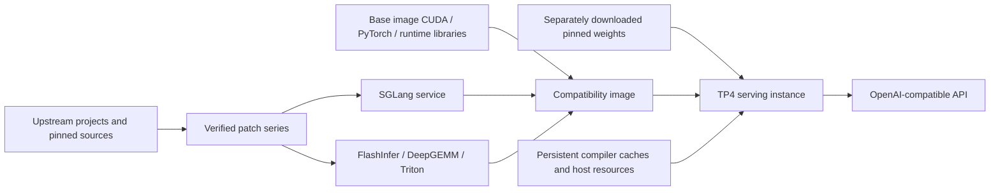
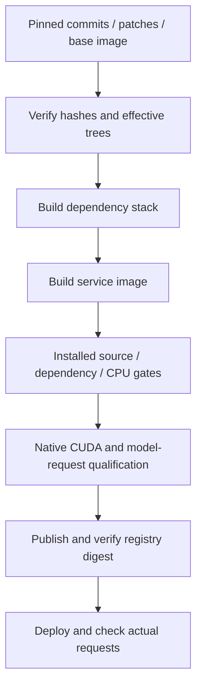

# DeepSeek 1017 / SGLang engineering handbook

[中文](ENGINEERING.zh-CN.md) · [Overview](../README.md) · [Engineering retrospective](RETROSPECTIVE.md) · [Test record](../TESTING.md)

Compiled on 2026-11-05 for operators and maintainers. This handbook covers inference-framework adaptation, container engineering and operating profiles for DeepSeek-V4.1-Flash-1017 on four SM120 GPUs. Model weights were neither trained nor modified. Experiment dates, samples and limits belong to the test records; this is not a live service-status page.

## 1. Deliverables and provenance

| Item | Current evidence |
| --- | --- |
| Model | `deepseek-ai/DeepSeek-V4.1-Flash-1017`, revision `1bae0e1088993b9b82de08f59de5be5a34e42170` |
| Published candidate | `ghcr.io/loon-hejw/sglang-deepseek-v41-flash-sm120-compat:v0.4.4-rc.4` |
| Linux amd64 manifest | `sha256:0a32f40290db16a139ee2ac38ec4a8641b7310de07b79a249dd1c11d46a48a92` |
| Build source | `b808761fbef06cec27ce7b3afc55c372cefa78c1`; later documentation commits do not identify a new runtime image |
| Qualification | Candidate, not a stable fork release; literal generation in tool arguments remains unreliable |
| Records | [Source lock](../stack.lock.json), [migration decisions](../compat/migration.json), [validation](../compat/validation.json), [publication receipt](../compat/publication.json) |

This fork builds on [ormandj's V4.1/1017 project](https://github.com/ormandj/sglang-deepseek-v41-flash-sm120) and adapts applicable fixes from [Ombori's 0731 project](https://github.com/ombori/deepseek-v4-flash-0731-sglang-4x-rtx-pro-6000). The first supplies the pinned stack, SM120 optimization series, TP4/EP2 recipe and DSPARK/SPS integration; the second supplies older deployment experience and correctness-patch provenance. Frameworks, algorithms, kernels and original patches remain credited to their authors in [NOTICE](../NOTICE.md) and the [patch table](../README.md#source-and-patches).



The vendor base supplies runtime dependencies, not source provenance for rebuilt components. The lock records source commits, patch hashes and effective trees. The 41 SGLang patches include inherited work; they are not all new contributions by this fork.

## 2. Changes and source entry points

| Behavior | Implementation | Validation focus |
| --- | --- | --- |
| Speculative penalties | [Penalty application](../patches/33-compat-verify-penalties.patch) and [committed-token state](../patches/34-compat-committed-penalty-state.patch); count committed output and apply repetition scaling using actual logits signs | Additive/scaling combinations, zero crossings, reuse, filter and merge |
| Tool completion | [Final argument flush](../patches/35-compat-tool-final-flush.patch) for all calls and final name chunks, without duplicate emission | Multiple tools, final chunks and repeated finalization |
| Markers split in normal text | [Prefix holdback](../patches/36-compat-reasoning-prefix.patch) extends ordinary-text handling | No fragment leakage or lost content across chunks |
| Batched routing | [Preserve routing_key](../patches/37-compat-request-routing-key.patch) | Sliced requests retain the field |
| Warmup and sampling limits | [DeepGEMM budget](../patches/38-compat-deepgemm-warmup-budget.patch), [draft sentinel](../patches/39-compat-draft-sentinel.patch) | Skip unsupported memory demand; keep degenerate token ids in range |
| Literals inside V4.1 tools | [Parser-state boundaries](../patches/41-v41-tool-literal-reasoning.patch) | Chunk boundaries preserve raw arguments; distinguish parser fidelity from generation correctness |
| Regressions | [CPU coverage](../patches/40-compat-cpu-regressions.patch), [migration checker](../scripts/check-migration.py) | Check actual locked code and behavior; CPU checks do not replace CUDA or serving validation |
| Build and operations | [Builder](../scripts/build-compat.sh), [monitored builder](../scripts/run-build-monitored.py), [launcher](../examples/serve-compat-tp4.sh) | Traceable sources, visible failures, explicit profiles and API-key redaction in dry runs |

The 33 old patch decisions are 7 ported, 22 already equivalent and 4 not applicable. Seven is a decision count, not the number of newly created patch files. Original patches and author links remain in the migration record. The fork does not restore old C4 layouts or make the 0731 DP4 / 256-request / block-7 recipe the 1017 default.

## 3. Hardware and resource preparation

Measured instances used four 96 GB RTX PRO 6000 Blackwell GPUs with PCIe P2P and no NVLink. The host had two Xeon Platinum 8480+ CPUs, 503 GiB RAM, driver 610.43.02 and 600 W GPU limits. These describe measured conditions, not performance promises for other hosts.

Weights occupy about 480 GiB of disk; budget additional space for images, builds and caches. Engram host tables require about 189 GiB, plus HiCache, runtime and OS allocations. Two instances duplicate host tables. The retained shared-host profile has a 224 GiB container limit, no swap, a 16 CPU quota and matching NUMA placement.

On a Linux amd64 Docker host with GPU support, inspect devices, P2P/topology, NUMA, memory and disk. Choose GPU indices and the memory node from that host's results:

```bash
nvidia-smi
nvidia-smi topo -m
numactl --hardware
free -h
df -h /srv
docker info --format '{{.OSType}}/{{.Architecture}}'
```

Exclusive ownership of selected GPUs is arranged by the scheduler or operator. The public launcher neither reserves Kubernetes GPUs nor monitors host headroom continuously. Historical deployment guards requiring 232 GiB available before startup and stopping a test instance below 8 GiB available were site-specific supervision, not launcher functionality.

## 4. Building and checking the supply chain



Use a clean checkout on the build host and follow [BUILDING](../BUILDING.md):

```bash
export COMPAT_MAX_JOBS=4
bash scripts/build-compat.sh --dry-run
bash scripts/build-compat.sh
```

The expected local target is `local/sglang-deepseek-v41-flash-sm120-compat:v0.4.4-rc.4`. The script builds the dependency stack, then the service image, with installed-image checks. A rebuild is a different artifact and cannot inherit qualification merely by sharing a tag. Build dry-run writes ignored temporary recipes; the real build requires a clean working tree and does not publish or deploy.

To monitor resources, replace the real build command with `python3 scripts/run-build-monitored.py`. It stops its build process group below 96 GiB available RAM or 200 GiB free disk, without stopping other services. The ordinary builder does not implement these dynamic thresholds.

Restricted networks can use `COMPAT_BASE_IMAGE`, `COMPAT_BASE_SOURCE`, `COMPAT_BASE_RECEIPT` and `COMPAT_SOURCE_CACHE` as documented in BUILDING. Mirrored bases must pass raw-manifest, config and ordered-RootFS checks; cached sources must pass commit, patch and effective-tree checks. Matching tags alone are insufficient.

Build integration fixes install FlashInfer compiler dependencies before enabling `FLASHINFER_BUILD_NO_PIP=1`, pass Triton's test-build setting through `TRITON_APPEND_CMAKE_ARGS`, and retain `pipefail` when filtering repetitive cubin output. Logs remain readable without converting compiler failures into successful builds.

## 5. Deploying the published artifact

The publication receipt records a private GHCR package without verified anonymous pulls. Authenticate with package-read access and keep credentials in the runtime environment. The following sequence assumes Docker GPU support and the Hugging Face CLI are installed; model-repository access requirements apply.

```bash
git clone https://github.com/loon-hejw/sglang-deepseek-v41-flash-sm120-compat.git
cd sglang-deepseek-v41-flash-sm120-compat
docker login ghcr.io
export IMAGE=ghcr.io/loon-hejw/sglang-deepseek-v41-flash-sm120-compat:v0.4.4-rc.4
docker pull --platform linux/amd64 "$IMAGE"
docker image inspect --format '{{json .RepoDigests}}' "$IMAGE"
docker image inspect --format '{{index .Config.Labels "org.opencontainers.image.revision"}}' "$IMAGE"
hf download deepseek-ai/DeepSeek-V4.1-Flash-1017 \
  --revision 1bae0e1088993b9b82de08f59de5be5a34e42170 \
  --local-dir /srv/models/DeepSeek-V4.1-Flash-1017

export MODEL_DIR=/srv/models/DeepSeek-V4.1-Flash-1017
export CACHE_DIR=/srv/cache/sglang-deepseek-v41-compat-v0.4.4-rc.4-tp4
export GPU_DEVICES=0,1,2,3
export HOST_PROFILE=shared
# Example only: match this node to the GPU topology inspected above.
export NUMA_MEMORY_NODE=0
export HICACHE_RATIO=0.1
export PORT=18001
export CONTAINER_NAME=deepseek-v41-flash-sm120-compat-tp4
bash examples/serve-compat-tp4.sh --dry-run
bash examples/serve-compat-tp4.sh
```

Before startup, compare the inspected repository digest and source label with the first table and publication receipt. Serving dry-run requires `config.json` in the model directory, writes no cache directory, starts no Docker container and masks the API key. The real launcher exposes exactly the selected four GPUs, mounts weights read-only and persists `/root/.cache`. The detached container is retained after exit with restart policy `no`. Set `API_KEY` in the environment to enable bearer authentication; network exposure is managed by the deployment environment.

### Retained profile versus defaults

| Item | Retained shared-host configuration | Interface or qualification |
| --- | --- | --- |
| Parallelism | TP4 / attention DP1 / EP2 | Fixed TP4/EP2; no DP attention or DP LM head |
| Speculation | DSPARK block 5, SPS auto | Fixed profile; SPS sampling temperature/top_p 1 |
| Memory / KV | 0.85 / FP8 E4M3 | `MEM_FRACTION=0.85` does not cap every CUDA allocation |
| Context / running requests | 1,048,576 / 16 | `CONTEXT_LENGTH` / `MAX_RUNNING_REQUESTS`; this launcher supports at most 16 |
| Prefill / decode graph | 8192 / 16 | Both chunk and max prefill tokens are 8192 |
| Backends | dsv4 / flashinfer_mxfp4 / flashinfer_cutlass | Attention / MoE / FP8 GEMM |
| Host / cache | 224 GiB, no swap, 16 CPUs, THP disabled for this process tree, HiCache 0.1 | Requires explicit `HOST_PROFILE=shared` and a NUMA memory node |
| Without shared selection | Dedicated; HiCache default 2 | Does not apply those CPU/memory caps; differs from the retained shared-host recipe |
| Request sampling | OpenAI defaults, temperature/top_p 1 | Explicit client fields override defaults; low coding profile is selected separately |

See [RUN](../RUN.md) and the launcher for all options and fixed switches. An inherited `HICACHE_RATIO` overrides profile defaults, so set it explicitly when reproducing results. The launcher is not a general sweep interface for DSPARK block size, SPS or TP/EP.

### Readiness and request checks

```bash
docker logs --follow "$CONTAINER_NAME"
```

After readiness, use another terminal. When authentication is enabled, supply the key for model/request checks:

```bash
curl --fail http://127.0.0.1:18001/health
curl --fail -H "Authorization: Bearer ${API_KEY}" http://127.0.0.1:18001/v1/models
```

Omit the authorization header when no key is configured, and change URLs if the port differs. Also send an actual `/v1/chat/completions` request and inspect the model name, complete nonempty content, finish reason and tool arguments. Readiness, a health response or HTTP 200 alone does not establish answer correctness.

For a coding check, save this as `request.json` and use the existing client:

```json
{
  "model": "deepseek-v4.1-flash-1017",
  "messages": [{"role": "user", "content": "Implement Python valid_brackets(text) for matching ()[]{} while ignoring other characters. Return only Python code."}]
}
```

```bash
INFERENCE_BASE_URL=http://127.0.0.1:18001/v1 python3 examples/code-request.py --request request.json
```

The authentication variable is `INFERENCE_API_KEY`. The client fills temperature 1, reasoning effort low, top_p 1 and max_tokens 12288 while preserving explicit overrides. Truncation, abnormal termination or empty final content is an error; reasoning is not promoted to code and no retry is automatic. Run application tests on generated code.

Thinking activation is separate from its default strength. With `SGLANG_DEFAULT_THINKING` unset, omitting both the effort and thinking toggle uses chat mode; supplying a non-none effort enables thinking unless the caller explicitly disables it. The [quality-policy guide](QUALITY.md) documents measured encoding checks, task-specific profiles and held-out qualification. It does not change server defaults.

## 6. Caches, restarts and moving hosts

| Object | Reuse boundary |
| --- | --- |
| Image and build layers | Compatible hosts can pull the built image; every startup does not require a full source rebuild |
| TorchInductor / Triton / TileLang caches | Persist through the bind mount; compatibility depends on image, architecture and shapes. Observe actual cache hits/compilation |
| SPS cost tables | Reflect hardware and communication costs; measure again on a different host rather than relying on GPU model names |
| CUDA Graphs | Process-local; captured again after restart, not portable disk artifacts |
| Weights and Engram tables | Still loaded and initialized each start; compilation caches do not imply instant readiness |

An earlier empty-cache start of `local/sglang-deepseek-v41-flash-sm120-compat:v0.4.4-rc.3` took 2343 seconds including compilation, graph capture and SPS. This is not a warm-restart promise for the current candidate; no controlled warm-restart timing is recorded. Preserve cache mounts and distinguish container startup from rebuilding the framework image.

Before migration, verify platform, GPU capacity/P2P, driver, NUMA, RAM, disk, image digest and pinned weights. Use a separate target cache directory. Retain source caches as evidence, but do not overwrite the only copy or assume all binary entries are portable. Record weight loading, compilation/cache reuse, SPS, graph capture, readiness and actual requests separately when qualifying the target.

## 7. Stop, upgrade and rollback

Normal lifecycle commands preserve the container and cache:

```bash
docker stop --time 120 "$CONTAINER_NAME"
docker start "$CONTAINER_NAME"
```

`docker start` uses the saved container configuration, not new shell parameters. Parameter changes require a new container; the launcher fails if its name already exists rather than replacing it.

For an upgrade: record the old image digest, configuration and cache location; pull and verify an independently qualified new image; choose a new name and separate cache and dry-run first; stop the old instance during the maintenance window to free its GPUs; start the new instance and check health, ordinary requests, tools and code. Roll back by stopping the new instance before starting the retained old container. Keep old containers, images and caches until qualification completes. Raw inspect output containing credentials belongs only in restricted local storage.

Parallel qualification on spare GPUs requires separate ports, names, caches and matching NUMA placement, plus memory for another Engram allocation. The launcher does not implement traffic switching or automatic rollback.

## 8. Private registries and publication

For a registry such as Harbor, use environment-specific `REGISTRY_HOST` and `REGISTRY_PROJECT` values. Prepare a project and account with write access, then use a copy method that preserves the runtime manifest content. Verify the target Linux amd64 manifest, config and all layers and retain a receipt. Repackaging or rebuilding cannot silently inherit the original digest and qualification identity.

This publication reused the tested runtime manifest, config and all 79 layers without rebuilding. The unpublished local index additionally contained a build attestation, explaining its different digest. The receipt is authoritative for the published artifact.

GitHub `validate.yml` checks main pushes. Candidate builds, stable promotion and Release publication use separate manual workflows described in BUILDING. Image-input changes require a new candidate version; published tags are immutable. Documentation and launcher examples do not rebuild the candidate, and the latest repository commit is not automatically the image's build commit.

## 9. Validation and troubleshooting

| Layer | Recorded result and meaning |
| --- | --- |
| Local source-body CPU | 279 passed; isolated real function bodies, not GPU execution |
| Installed-image CPU | 1198 passed and 691 subtests; one CUDA-only test skipped |
| Native CUDA | Eight Triton Markov combine / CUDA Graph replay cases passed; not a rerun of that skipped test |
| Real model | Quality, coding policies, literal tools and partial throughput comparisons; see TESTING for samples |
| Full source command | Historically incomplete because of Docker Hub networking; effective source trees and base identity were checked separately, not one successful uninterrupted network run |

Prepare Python 3.12 as in README and run `scripts/test-compat.sh` and `scripts/check-migration.py` against the correct prepared patched sources. A stale source cache can fail hashes or behavior; verify the locked tree rather than changing expectations to hide the mismatch. Start the API checker `scripts/validate-gpu.py` with dry-run and explicit test endpoints, the actual model name and matched conditions. It does not replay all historical experiments.

| Symptom | Investigation and response |
| --- | --- |
| No KV pool after weight loading | Check memory and topology; 0.80 failed and 0.85 passed for the original profile, while DP4 needed 0.90. These are observations, not a universal instruction to increase memory fraction |
| Host memory pressure | Account for Engram, HiCache, other services and NUMA headroom; a container cap is not a guarantee of available host memory |
| Build appears stuck | Distinguish resource pressure, installer locks, network pulls and actual compilation; inspect monitored logs and exit codes, not elapsed time alone |
| Unauthorized image pull | Check account/package access, target project and full image reference; keep tokens out of public logs |
| Code exhausts output budget | Inspect finish_reason, reasoning-token use and final content; explicitly try the tested low profile, then validate harder workloads separately |
| Tool literals are wrong | Compare raw generation with parsing; fidelity does not guarantee semantic correctness. Validate arguments without silently reconstructing them from prompts |
| token/s disagrees with logs | Align per-request versus aggregate rates, TTFT, reasoning tokens, concurrency, input lengths and caches |

Full 1M input, TP8, matched 1M/256K workloads and independent DSPARK/SPS sweeps remain unqualified. Handoffs should include artifact identity, configuration, hardware, cache state, acceptance results, rollback entry points and unfinished checks. Publish only sanitized summaries.
