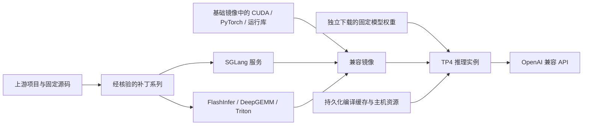
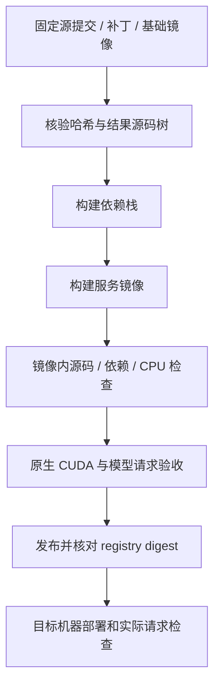

# DeepSeek 1017／SGLang 工程交付手册

[English](ENGINEERING.md) · [项目总览](../README.zh-CN.md) · [技术复盘](RETROSPECTIVE.zh-CN.md) · [测试记录](../TESTING.zh-CN.md)

本文整理于 2026-11-05，面向部署、运维和后续开发。范围是 DeepSeek-V4.1-Flash-1017 在四张 SM120 GPU 上的推理框架适配、镜像工程和运行策略；没有训练或修改模型权重。实验截止日期、样本及限制以测试记录为准，本文不是实时服务状态页。

## 1. 交付物与来源

| 项目 | 当前依据 |
| --- | --- |
| 模型 | `deepseek-ai/DeepSeek-V4.1-Flash-1017`，修订 `1bae0e1088993b9b82de08f59de5be5a34e42170` |
| 已发布候选 | `ghcr.io/loon-hejw/sglang-deepseek-v41-flash-sm120-compat:v0.4.4-rc.4` |
| Linux amd64 清单 | `sha256:0a32f40290db16a139ee2ac38ec4a8641b7310de07b79a249dd1c11d46a48a92` |
| 镜像构建源码 | `b808761fbef06cec27ce7b3afc55c372cefa78c1`；后续文档提交不等于新的运行镜像 |
| 版本状态 | 候选版；尚未提升为本项目稳定版，工具参数字面量生成仍不可靠 |
| 可追溯记录 | [源码锁定](../stack.lock.json)、[迁移决定](../compat/migration.json)、[验证](../compat/validation.json)、[发布回执](../compat/publication.json) |

本项目基于 [ormandj 的 V4.1/1017 项目](https://github.com/ormandj/sglang-deepseek-v41-flash-sm120)，参考 [Ombori 的 0731 项目](https://github.com/ombori/deepseek-v4-flash-0731-sglang-4x-rtx-pro-6000)进行兼容迁移。前者提供锁定构建栈、SM120 优化系列、TP4/EP2 配方及 DSPARK/SPS 集成；后者提供旧版部署经验和正确性补丁来源。框架、算法、内核及原补丁的贡献属于原作者，完整声明见 [NOTICE](../NOTICE.md) 和 [README 补丁表](../README.md#source-and-patches)。



基础镜像只提供运行环境，不能替代 SGLang 等组件的源码溯源。锁文件记录 SGLang、FlashInfer、DeepGEMM、Triton 的提交、补丁哈希和结果源码树。当前 SGLang 系列共 41 个补丁，包含继承内容；不能全部算成本项目新增。

## 2. 修改范围与代码入口

| 行为 | 处理方法与入口 | 验证重点 |
| --- | --- | --- |
| 推测解码惩罚 | [惩罚计算](../patches/33-compat-verify-penalties.patch)与[已提交 token 状态](../patches/34-compat-committed-penalty-state.patch)；累计已提交输出，在实际 logits 符号上应用重复惩罚 | 加性/乘性组合、跨零、批复用、过滤和合并 |
| 工具调用收尾 | [完整参数刷新](../patches/35-compat-tool-final-flush.patch)；处理全部工具和最终名称分片，避免重复发出 | 多工具、最终分片、重复结束 |
| 普通正文标签分片 | [前缀暂存](../patches/36-compat-reasoning-prefix.patch)；补齐普通正文状态的跨分片处理 | 标签被拆开时不泄漏、不吞掉正文 |
| 批请求路由 | [保留 routing_key](../patches/37-compat-request-routing-key.patch) | 切片后请求字段保持一致 |
| 预热与采样边界 | [DeepGEMM 内存预算](../patches/38-compat-deepgemm-warmup-budget.patch)、[草稿 sentinel](../patches/39-compat-draft-sentinel.patch) | 无可容纳形状时跳过预热；退化分数下 token id 不越界 |
| V4.1 工具体中的字面量 | [解析状态边界](../patches/41-v41-tool-literal-reasoning.patch) | 流式分片不改变工具体内原始参数；与模型生成正确性分开判定 |
| 回归覆盖 | [CPU 回归](../patches/40-compat-cpu-regressions.patch)及[迁移核验](../scripts/check-migration.py) | 对照固定源码和行为，不用 CPU 检查代替 CUDA 或真实模型验收 |
| 构建与部署工程 | [构建入口](../scripts/build-compat.sh)、[资源监控构建](../scripts/run-build-monitored.py)、[启动入口](../examples/serve-compat-tp4.sh) | 来源可追溯、失败可见、参数显式、API Key 在 dry-run 中隐藏 |

0731 的 33 项决定为 7 项迁移、22 项已有等效实现、4 项不适用；“7 项迁移”是旧补丁决定数，不等同于当前新增补丁文件数。原补丁及作者引用保留在迁移记录中。没有恢复旧版 C4 布局，也没有把 0731 的 DP4、256 并发、block 7 配方直接设为 1017 默认值。

## 3. 环境与资源准备

已测硬件为每实例四张 96 GB RTX PRO 6000 Blackwell、PCIe P2P、无 NVLink；宿主机双路 Xeon Platinum 8480+、503 GiB RAM，驱动 610.43.02，单卡功率上限 600 W。这些是测量条件，不是对其他硬件的性能承诺。

权重约占 480 GiB 磁盘，需另留镜像、构建和缓存空间。Engram 主机表约占 189 GiB，除此之外还有 HiCache、运行时和系统内存；两个模型实例会分别分配主机表。共享主机实测使用 224 GiB 容器内存限额、无 swap、16 CPU 配额和对应 NUMA 节点。

在 Linux amd64 Docker 主机上检查 GPU 可见性、驱动、P2P、内存和磁盘。以下命令是只读检查；GPU 编号和 NUMA 节点必须按目标机器选择：

```bash
nvidia-smi
nvidia-smi topo -m
numactl --hardware
free -h
df -h /srv
docker info --format '{{.OSType}}/{{.Architecture}}'
```

独占选定 GPU 的安排由集群调度器或运维流程完成。公共启动器不预留 Kubernetes 资源，也不持续监督主机余量。历史实测的启动前 232 GiB 可用内存门槛及低于 8 GiB 时停止测试副本的保护属于现场监督逻辑，不包含在启动器内。

## 4. 构建与供应链校验



需要重新构建时，使用干净 checkout，并按 [BUILDING](../BUILDING.md) 执行：

```bash
export COMPAT_MAX_JOBS=4
bash scripts/build-compat.sh --dry-run
bash scripts/build-compat.sh
```

预期生成 `local/sglang-deepseek-v41-flash-sm120-compat:v0.4.4-rc.4`，依次构建依赖栈和服务镜像，执行镜像内检查。自行重建是新产物，不能仅因标签相同继承已发布镜像的验收结论。构建 dry-run 会写入被 Git 忽略的临时构建配方；实际构建要求干净工作区，不自动推送或部署。

需要监控构建资源时，用 `python3 scripts/run-build-monitored.py` 替代上面的实际构建命令。它在可用内存低于 96 GiB 或磁盘低于 200 GiB 时中止构建进程组，不停止其他服务。普通构建脚本不执行这两项动态阈值检查。

受限网络可使用 `COMPAT_BASE_IMAGE`、`COMPAT_BASE_SOURCE`、`COMPAT_BASE_RECEIPT` 和 `COMPAT_SOURCE_CACHE`，具体接口见 BUILDING。基础镜像镜像源必须通过原始 manifest、config 和有序 RootFS 层核验；源码缓存必须通过提交、补丁和结果树核验，不能用“标签相同”替代来源检查。

构建集成修复包括先安装 FlashInfer 编译依赖再设置 `FLASHINFER_BUILD_NO_PIP=1`，避免嵌套安装锁；通过 `TRITON_APPEND_CMAKE_ARGS` 传递测试构建开关；过滤重复 cubin 日志时保留 `pipefail`，保证编译错误仍会使构建失败。

## 5. 使用已发布镜像部署

发布回执记录 GHCR 包为私有，未验证匿名拉取。使用有读取权限的账户登录，凭据留在运行环境。以下流程从获取仓库开始，其余命令在仓库根目录执行，前提是已安装 Docker GPU 支持和 Hugging Face CLI；下载权限由模型仓库控制。

```bash
git clone https://github.com/loon-hejw/sglang-deepseek-v41-flash-sm120-compat.git
cd sglang-deepseek-v41-flash-sm120-compat
docker login ghcr.io
export IMAGE=ghcr.io/loon-hejw/sglang-deepseek-v41-flash-sm120-compat:v0.4.4-rc.4
docker pull --platform linux/amd64 "$IMAGE"
docker image inspect --format '{{json .RepoDigests}}' "$IMAGE"
docker image inspect --format '{{index .Config.Labels "org.opencontainers.image.revision"}}' "$IMAGE"
hf download deepseek-ai/DeepSeek-V4.1-Flash-1017 \
  --revision 1bae0e1088993b9b82de08f59de5be5a34e42170 \
  --local-dir /srv/models/DeepSeek-V4.1-Flash-1017

export MODEL_DIR=/srv/models/DeepSeek-V4.1-Flash-1017
export CACHE_DIR=/srv/cache/sglang-deepseek-v41-compat-v0.4.4-rc.4-tp4
export GPU_DEVICES=0,1,2,3
export HOST_PROFILE=shared
# 示例值，须与 nvidia-smi topo -m 和 numactl 的检查结果相符。
export NUMA_MEMORY_NODE=0
export HICACHE_RATIO=0.1
export PORT=18001
export CONTAINER_NAME=deepseek-v41-flash-sm120-compat-tp4
bash examples/serve-compat-tp4.sh --dry-run
bash examples/serve-compat-tp4.sh
```

启动前将 inspect 输出的仓库摘要和源码标签与首表及发布回执核对。dry-run 需要模型目录中的 `config.json`，不创建缓存目录或启动容器，输出中的 API Key 会隐藏。实际启动只向容器暴露指定四张卡，权重只读挂载，缓存挂到 `/root/.cache`；容器退出后保留，重启策略为 `no`。可在当前环境设置 `API_KEY` 启用鉴权，网络暴露策略由部署环境管理。

### 保留配置与默认值

| 项目 | 实验后保留的共享主机配置 | 启动器接口或说明 |
| --- | --- | --- |
| 并行 | TP4 / Attention DP1 / EP2 | 固定 TP4/EP2，未开启 DP attention 或 DP LM head |
| 推测解码 | DSPARK block 5，SPS auto | 固定 profile；SPS 采样 temperature/top_p 为 1 |
| 显存 / KV | 0.85 / FP8 E4M3 | `MEM_FRACTION=0.85`，不是全部 CUDA 分配的总上限 |
| 上下文 / 运行请求数 | 1,048,576 / 16 | `CONTEXT_LENGTH` / `MAX_RUNNING_REQUESTS`；当前入口最多 16 |
| Prefill / decode graph | 8192 / 16 | chunk 和 max prefill tokens 均为 8192 |
| 后端 | dsv4 / flashinfer_mxfp4 / flashinfer_cutlass | 分别为 attention / MoE / FP8 GEMM |
| 主机 / 缓存 | 224 GiB、无 swap、16 CPU、THP 仅本进程树关闭、HiCache 0.1 | 必须显式设置 `HOST_PROFILE=shared` 和 NUMA 节点 |
| 未选择 shared 时 | dedicated；HiCache 默认 2 | 不自动套用上述 CPU/内存限额；不是最后保留的共享主机配方 |
| 请求采样 | OpenAI 默认值；temperature/top_p 1 | 客户端显式字段优先；代码 low 预设需要另外选择 |

更多环境变量、固定开关和约束以 [RUN](../RUN.md) 与启动脚本为准。已有 shell 中残留的 `HICACHE_RATIO` 会覆盖 profile 默认值，复现时应明确设置。DSPARK block、SPS 和 TP/EP 不是当前启动器的通用扫描接口。

### 就绪与请求检查

```bash
docker logs --follow "$CONTAINER_NAME"
```

就绪后在另一个终端检查以下端点；若设置了 API Key，模型和请求检查需要相应鉴权头：

```bash
curl --fail http://127.0.0.1:18001/health
curl --fail -H "Authorization: Bearer ${API_KEY}" http://127.0.0.1:18001/v1/models
```

未启用鉴权时省略 `Authorization` 头。若端口不同，替换 URL。健康返回 200 后还应发送实际 `/v1/chat/completions` 请求，核对模型名、完整非空正文、结束原因和工具参数；启动日志、健康接口或 HTTP 200 本身不能证明答案正确。

代码任务可以保存以下内容为 `request.json` 并使用已有客户端：

```json
{
  "model": "deepseek-v4.1-flash-1017",
  "messages": [{"role": "user", "content": "Implement Python valid_brackets(text) for matching ()[]{} while ignoring other characters. Return only Python code."}]
}
```

```bash
INFERENCE_BASE_URL=http://127.0.0.1:18001/v1 python3 examples/code-request.py --request request.json
```

鉴权环境变量为 `INFERENCE_API_KEY`。客户端默认补充 temperature 1、reasoning_effort low、top_p 1、max_tokens 12288，保留显式覆盖；截断、异常结束或空正文会报错，不把推理正文当代码，也不自动重试。生成代码仍需应用自身测试。

思考开关与默认强度是两回事。未设置 `SGLANG_DEFAULT_THINKING` 时，同时省略强度与思考开关会进入非思考模式；显式传入非 none 强度会启用思考，除非调用方显式关闭。[质量策略说明](QUALITY.zh-CN.md)记录了实际编码核对、分任务预设和留出验收，不改变服务默认值。

## 6. 缓存、重启和更换主机

| 对象 | 复用边界 |
| --- | --- |
| 镜像与基础构建层 | 同一兼容机器可直接拉取已构建镜像，不必为每次启动重新编译整个框架 |
| TorchInductor / Triton / TileLang 等运行时缓存 | 持久化在缓存挂载中；依赖镜像、架构和运行形状，是否命中需观察实际日志 |
| SPS 代价表 | 反映硬件与通信代价；换主机需重新测量，不能只凭 GPU 型号相同推断可复用 |
| CUDA Graph | 属于当前进程，重启仍需捕获，不能作为磁盘缓存直接搬走 |
| 模型和 Engram 表 | 每次启动仍需加载和建立运行时状态；有编译缓存不等于瞬间就绪 |

早期 `local/sglang-deepseek-v41-flash-sm120-compat:v0.4.4-rc.3` 的空缓存首次启动实测为 2343 秒，包含编译、图捕获和 SPS；这不是 rc.4 的热重启承诺，尚无受控热重启计时。保留缓存目录，避免把“容器重新启动”和“从源码重建镜像”混为一谈。

迁移时先核对目标平台、GPU 容量与 P2P、驱动、NUMA、RAM 和磁盘，验证镜像摘要与固定权重；为目标实例准备独立缓存目录。可保留原缓存作参考，但不要直接覆盖唯一副本或假定全部二进制缓存可用。以加载、编译/缓存命中、SPS、图捕获、就绪和实际请求分阶段记录时间，再决定目标机器是否合格。

## 7. 停止、升级与回滚

普通生命周期命令保留容器和缓存：

```bash
docker stop --time 120 "$CONTAINER_NAME"
docker start "$CONTAINER_NAME"
```

`docker start` 使用旧容器保存的命令，不读取新的 shell 参数。改参数需要创建新容器；同名容器已存在时启动器会失败，而不是替换它。

升级顺序固定为：记录旧镜像摘要、配置和缓存路径；拉取并校验已经独立验收的新镜像；为新实例选择不同容器名和独立缓存，先 dry-run；在维护窗口停止旧实例释放所选 GPU；创建新实例并完成健康、普通请求、工具和代码检查。回滚时先停止新实例，再 `docker start` 原容器。保留旧容器、镜像与缓存直到确认新实例可用，原始 inspect 输出如含凭据只留在受限本地目录。

使用其他空闲 GPU 并行验证时，端口、容器名、缓存和 NUMA 绑定都要独立，同时计入第二份 Engram 主机内存。当前启动器不实现流量切换或自动回滚。

## 8. 私有仓库与发布

目标仓库按环境设置为 `REGISTRY_HOST` 和 `REGISTRY_PROJECT`，例如 Harbor。先创建有写入权限的目标项目并登录，再使用能保持运行清单内容的复制方式；复制完成后核对目标 Linux amd64 manifest、config 和全部层，保存回执。普通重新打包或重新构建后不能沿用原摘要和验收身份。

这次发布复用了已测运行 manifest、config 和全部 79 层，没有重新编译；未发布的本地索引另含构建证明，因此索引与平台清单摘要不同。具体事实以发布回执为准。

GitHub 的 `validate.yml` 在 main 推送时校验；构建候选、提升稳定版和发布 Release 为独立的手动工作流，见 BUILDING。修改镜像输入必须提升候选版本；已发布 tag 不移动。文档或启动示例变更不重建现有候选，也不能把 GitHub 最新提交自动视为镜像构建提交。

## 9. 验证与故障处理

| 层级 | 已记录结果与解释 |
| --- | --- |
| 本地源码体 CPU | 279 项通过；隔离加载真实函数体，不替代 GPU |
| 镜像内 CPU | 1198 项、691 个子测试通过；1 项 CUDA 专用检查跳过 |
| 原生 CUDA | Triton Markov combine / CUDA Graph replay 8 项通过；不是上述跳过项的补跑 |
| 真实模型 | 质量、代码策略、工具字面量及部分吞吐对照；样本和结果见 TESTING |
| 完整来源命令 | 历史完整命令曾因 Docker Hub 网络问题未完成；结果源码树及基础镜像另行核验，不能描述为所有联网步骤一次通过 |

开发环境按 README 准备 Python 3.12，然后显式使用正确的已应用补丁源码目录运行 `scripts/test-compat.sh` 和 `scripts/check-migration.py`。错误版本的源码缓存会导致哈希或行为不匹配；先核对锁定源码树，不能通过改期望值掩盖问题。API 对照入口 `scripts/validate-gpu.py` 先 dry-run，并显式提供两侧测试端点、实际模型名和一致条件；它不重放所有历史实验。

| 现象 | 检查与处理 |
| --- | --- |
| 权重加载后无法分配 KV | 对照显存和并行拓扑；原配置 0.80 不可行、0.85 可行，DP4 实验另需 0.90。这不是通用的盲目加显存比例建议 |
| 主机内存吃紧 | 核算 Engram、HiCache、其他服务和 NUMA 节点余量；224 GiB 是容器限额，不是整机剩余内存保证 |
| 编译长时间无输出 | 区分资源耗尽、安装锁、网络拉取与实际编译；查看监控构建日志和退出码，不以等待时长单独判死锁 |
| 镜像拉取未授权 | 核对登录账户与包读取权限、目标项目和完整镜像引用；不要在公开日志中粘贴令牌 |
| 代码输出耗尽预算 | 检查 finish_reason、推理 token 与最终正文；可显式使用已测 low 请求预设，但更复杂任务仍需测试 |
| 工具参数含错误字面量 | 区分原始生成错误与解析改变；解析保真不保证模型正确，应用需验证参数，不从提示中静默重建答案 |
| token/s 与日志不一致 | 区分单请求/合计吞吐、TTFT、推理 token、并发、输入长度和缓存状态，再比较同一口径 |

完整 1M 输入、TP8、1M/256K 同负载对比及 DSPARK block/SPS 等逐项扫描尚未验证。交接时应附镜像身份、配置、硬件、缓存状态、验收记录、回滚入口和未完成项；公开仓库仅保留脱敏摘要。
